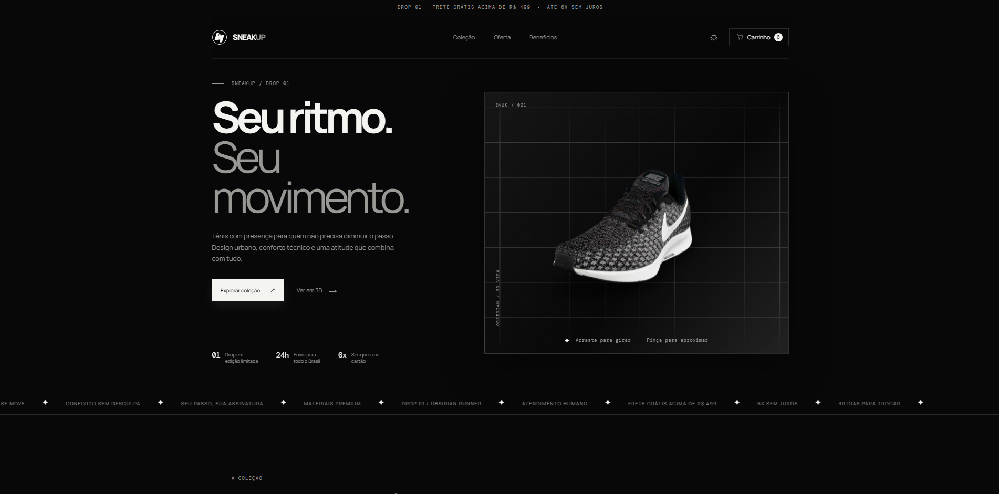

# 👟 ⎯ SneakUp

### Seu ritmo. Seu movimento.

A **SneakUp** é uma loja virtual de tênis esportivos desenvolvida para unir estética urbana, interação 3D e uma experiência de compra moderna. Com uma identidade visual em preto, grafite e branco, a plataforma apresenta produtos esportivos, ofertas em reais, carrinho de compras, modo White e uma área promocional com visualização 3D interativa.

## 🌐 Demonstração

🔗 **Acesse o projeto online:** https://shwnzzzz.github.io/SneakUp-ProjectShw/

## ✨ Funcionalidades

- 🏁 Hero section com modelo 3D interativo de tênis.
- 🛍️ Catálogo com tênis esportivos e produtos em destaque.
- 💰 Preços em reais, descontos e parcelamento sem juros.
- 🛒 Carrinho lateral com quantidades, subtotal e frete grátis.
- 🔎 Filtros por categoria: Corrida, Lifestyle e Treino.
- ↕️ Ordenação dos produtos.
- 🎯 Grande promoção com produto 3D, selo de desconto e últimas unidades.
- 🌗 Alternância entre Dark Mode e White Mode.
- ✨ Animações de brilho, grid, hover, iluminação e movimento.
- 📣 Barra infinita com informações de frete, trocas e benefícios.
- 💌 Formulário de newsletter.
- 📱 Layout responsivo para desktop, tablet e mobile.
- 🔖 Favicon personalizado da SneakUp.
- 💾 Carrinho e preferência de tema salvos no navegador.

## 🎨 Identidade Visual

O projeto utiliza uma identidade visual minimalista e esportiva, inspirada em vitrines premium e cultura sneaker.

- **Cores predominantes:** Preto, grafite, branco e cinza.
- **Estilo:** Dark/White Mode.
- **Design:** Editorial, moderno e tecnológico.
- **Tipografia:** Manrope e DM Mono.
- **Experiência:** Interativa, visual e orientada à descoberta de produtos.

## 🛠️ Tecnologias utilizadas

- HTML5
- CSS3
- JavaScript Vanilla
- Web Components com `<model-viewer>`
- Modelos 3D no formato glTF/GLB
- SVG para ícones, favicon e elementos visuais
- Imagens externas via Unsplash
- `localStorage` para persistência do carrinho e tema

## 📁 Estrutura principal

- `index.html` — estrutura da loja, hero, catálogo, promoção e carrinho.
- `styles.css` — identidade visual, responsividade e animações.
- `app.js` — produtos, filtros, ordenação, tema, newsletter e carrinho.
- `assets/sneakup-sneaker.glb` — modelo 3D principal do hero.
- `assets/sneakup-store-shoe.glb` — modelo 3D usado na grande promoção.
- `assets/sneakup-favicon.png` — favicon personalizado.
- `Sneakup.png` — imagem de apresentação do projeto.

## 🎯 Objetivo do projeto

A SneakUp foi desenvolvida como projeto de portfólio para praticar desenvolvimento web, construção de e-commerce, JavaScript, integração de modelos 3D e princípios de UI/UX Design. O objetivo é criar uma experiência de loja esportiva visualmente marcante, com navegação simples, foco em produto e sensação de marca premium.

## 👨‍💻 Desenvolvedor

**ShwDevs** Desenvolvimento de Software | UI/UX Design | Desenvolvimento Web e Mobile

---

  Desenvolvido com 🖤 por <strong>ShwDevs</strong>
   
  <strong>SneakUp — Seu ritmo. Seu movimento.</strong>

